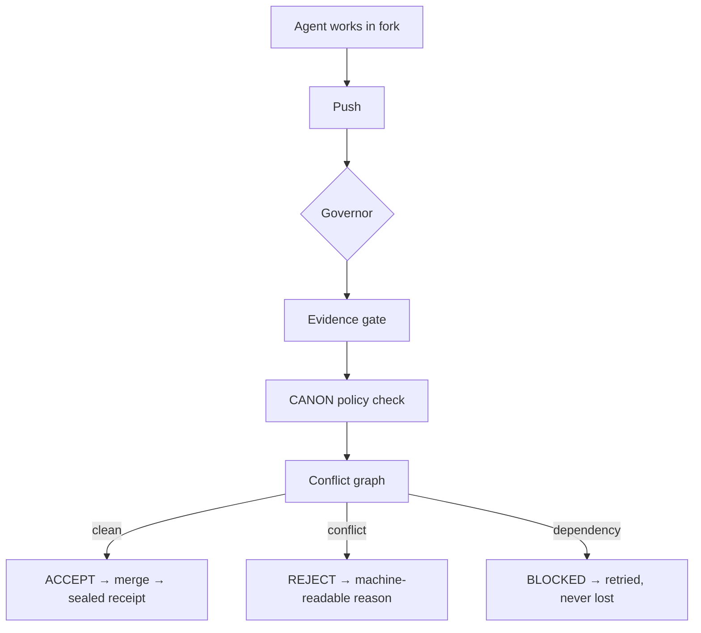

[Active R&D Lab] — latest CI run is failing; active development, expect rough edges.

# wreck — don't merge agents. Merge proven state transitions.

wreck is a **deterministic agent change-governance protocol** built for
Cloudflare's "build the next Git platform" competition. Cloudflare's
Artifacts supplies the versioned substrate (repos, forks, Git, events);
wreck supplies the layer Artifacts deliberately leaves open: **who decides
what ships when hundreds of agents push concurrently.**

The thesis, brutally:

> Git records competing states. It doesn't know why an agent made a change.
> Don't merge agents. Merge proven state transitions.

## The missing axis

Git records **WHAT** happened. wreck records **WHY it was allowed to happen**:

| Question | Answer |
|---|---|
| What changed? | Git / Artifacts |
| Why? | CANON — canonical rules with provenance |
| Evidence? | Proof ledger receipts (`lucidota-receipt/1` envelopes) |
| Can another agent build on it? | Change graph — textual ≠ semantic conflicts |
| Should it ship? | Governor: ELIGIBLE / REJECTED / BLOCKED |

## How it works

An agent doesn't open a PR. It proposes a **change claim** — a state
transition with intent, semantic claims, and evidence:



```
TASK → fork (repo per agent) → agent works → push
  → push event → governor → CHANGE CLAIM
    → evidence gate → policy (CANON) → conflict graph
      → ACCEPT → merge → sealed decision receipt
      → REJECT → machine-readable reason (rule + proof)
      → BLOCKED → waits on dependencies, retried, never lost
```

Status machine (forward only, no silent transitions):

```
PROPOSED → OBSERVED → CHECKED → PROVEN → ELIGIBLE → MERGED
                                  ↘ REJECTED (terminal)
```

Conflicts are classified, not just detected:

- **textual** — overlapping edits to the same file regions
- **semantic** — same invariant or symbol touched without textual overlap
- **dependency** — change needs an unmerged change
- **policy** — change touches a CANON-forbidden contract

Every verdict becomes a **sealed decision record**: change id, verdict,
base/head SHAs, CANON refs, claims checked, proofs, tests, conflicts,
policy result, decision hash, parent decision seal, and a
`lucidota-receipt/1` envelope. The review history is hash-chained —
an artifact, not UI metadata.

## Layout

```
wreck-protocol   change claim / evidence / decision / verdict types,
                 forward-only status machine, receipt sealing (Rust)
wreck-graph      change graph + deterministic conflict classifier (Rust)
wreck-governor   the merge authority: evidence → policy → graph → verdict (Rust)
wreck-canon      canonical rules store: the WHY with provenance (Rust)
wreck-adapters   substrate ports: MergePort trait + local-git impl (Rust)
wreck-wasm       governor core as a WASM module for Cloudflare Workers
wreck-worker     Worker event shell: queue → dedup → WASM decide → merge → seal
wreck-demo       5-agent "nasty auth" scenario + HTML change-field dashboard
                 + 50-agent scale harness
```

95/5: the engine is deterministic Rust. AI is a proposer (intent
extraction, semantic hints), never the judge.

## Reproduce it

Requires: Rust toolchain, git, C compiler (clang or gcc).

```sh
cargo test --workspace          # 119 tests, all green
cargo run -p wreck-demo         # the 5-agent nasty scenario
# → A,B,E merged · C rejected (textual+semantic) · D rejected (policy)
# → dashboard at /tmp/wreck-demo/dashboard.html
cargo run -p wreck-demo --bin wreck-scale 50   # 50 agents, 8+ decisions/sec
# WASM build needs a C compiler; if cc-rs can't find clang, use:
CC=gcc cargo build -p wreck-wasm --target wasm32-unknown-unknown  # Worker core
# Note: needs CC=gcc on systems without clang (cc-rs default)
```

Sample dashboard: `docs/dashboard-sample.html`.

## Cloudflare mapping

| wreck | Cloudflare |
|---|---|
| substrate port | Artifacts (repos, forks, repo-scoped tokens, Git) |
| event trigger | `cf.artifacts.repo.pushed` → Queue → Worker |
| merge lease | Durable Object (single writer onto `main`) |
| decision chain | D1 (receipts), KV (dedup + in-flight index) |
| deploy on verdict | Workers Builds (only `main` deploys) |
| dashboard | R2-hosted HTML from the decision chain |

The governor core is substrate-independent: local git today, Artifacts
tomorrow, via the same `MergePort` trait. Artifacts is the first
production adapter, not the intellectual property boundary.

## Status

Built Oct 8–14, 2026 for the Cloudflare competition. Local pipeline fully
working; Artifacts adapter lights up on Workers Paid access.
